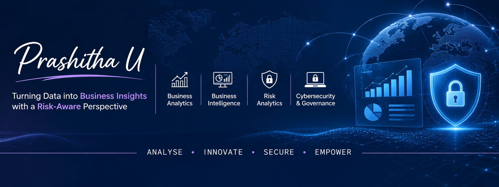

# Hi, I'm Prashitha Umasekaran 👋

### Business Analytics | Business Intelligence & Reporting | Cybersecurity Risk Analysis

I'm an MBA Business Analytics candidate with a Bachelor's degree in Computer Science and a postgraduate qualification in Cybersecurity & Digital Forensics.

I'm interested in using data and business analysis to understand operational challenges, develop meaningful reports, and support better business and risk-related decisions.

### Areas of Interest
- Business Analysis and Business Intelligence
- Data Analysis and KPI Reporting
- Dashboard Development and Visualisation
- Cybersecurity Risk Assessment
- Governance, Risk and Compliance (GRC)

### Skills and Tools
- **Analytics & Reporting:** Excel, Google Sheets, Power BI, Tableau
- **Database:** SQL, MySQL
- **Programming:** Python (Beginner)
- **Cybersecurity:** Risk Analysis, Security Awareness, Digital Forensics
- **Business Concepts:** Risk Prioritisation, Business Impact Analysis, Workforce Analytics

### Selected Projects

1. **[Wazuh Cybersecurity Risk Analysis](https://github.com/Prashitha-Umasekaran/wazuh-cybersecurity-risk-analysis)**  
   Historical hands-on case study using Wazuh, Kali Linux and Power BI to review security events, interpret potential risks and communicate findings through dashboards. Includes archived screenshots and documented evidence limitations.

2. **[Credit Risk Prediction](https://github.com/Prashitha-Umasekaran/credit-risk-prediction)**  
   Credit risk and loan delinquency analysis using a Forage job simulation and independent Python analysis.

3. **[Cybersecurity Risk Governance](https://github.com/Prashitha-Umasekaran/cyber-risk-goverance-platform)**  
   A risk governance project involving a risk register, SQL queries and a Power BI dashboard file.

4. **[Enterprise Ransomware Risk Analysis](https://github.com/Prashitha-Umasekaran/enterprise-ransomware-risk-analysis-case-study)**  
   A cybersecurity case study examining ransomware risks, business impact and mitigation measures.

4. **[Cybersecurity Risk Analysis Case Study](https://github.com/Prashitha-Umasekaran/Cybersecurity-Risk-Analysis-Case-Study)**  
   A case study focused on threat identification, risk assessment and mitigation planning.

### Education
- MBA – Business Analytics | NITTTR Chennai (2025–2027)
- PG Diploma – Cybersecurity & Digital Forensics | Rashtriya Raksha University
- B.Sc. Computer Science | Idhaya College of Arts and Science

### Currently Developing
- SQL and business data analysis
- Power BI and dashboard development
- Business intelligence and reporting
- Cybersecurity risk management and GRC

### Connect With Me
- [LinkedIn](https://www.linkedin.com/in/prashitha-u-415a47232/)
- [GitHub](https://github.com/Prashitha-Umasekaran)
